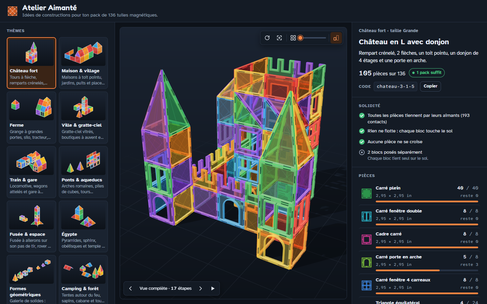

# Atelier Aimanté

Générateur d'idées de constructions pour un pack de 136 tuiles magnétiques
(option double pack : 272 pièces). On choisit un thème, une taille et une variante ;
l'appli produit une construction qui n'utilise que les pièces disponibles, la montre
en 3D, liste les pièces et découpe le montage en étapes.

**Démo en ligne : https://frn0406.github.io/atelier-aimante/**

Le pack de référence : 40 carrés pleins, 8 carrés fenêtre double, 8 cadres, 8 portes en
arche, 8 fenêtres 4 carreaux, 24 triangles équilatéraux, 14 triangles rectangles,
8 grands triangles isocèles, 8 demi-rectangles, 8 créneaux et 2 plateaux à roues.

## Utiliser

- En ligne : la démo ci-dessus.
- Hors ligne : double-cliquer `dist/atelier-aimante.html` (fichier unique ; Three.js est
  chargé depuis jsDelivr, il faut donc une connexion).
- Un code de construction (`chateau-3-1-5` = thème, taille, packs, variante) se colle
  dans le champ « Code » ou à la fin de l'adresse (`…html#chateau-3-1-5`).
- 10 thèmes (château, maison, ferme, ville, train, pont, fusée, Égypte, formes
  géométriques, camping), 4 tailles, option double pack pour la taille Géante.
- Le « thème libre » composé par Claude ne fonctionne que dans un artefact publié sur
  claude.ai ; ailleurs, le texte tapé mène à une idée toute prête (cirque, pirates,
  fête foraine, zoo, dragon, Noël, oasis) ou au thème le plus proche.

## Développer

| Commande | Rôle |
|---|---|
| `node build.cjs` | assemble `dist/atelier-aimante.html` et `dist/artifact.html` |
| `node test/run.cjs` | banc d'essai : tous les thèmes × tailles × packs × graines, et les modules |
| `node test/run.cjs --theme=chateau --seeds=40` | un thème, plus de graines |
| `node test/run.cjs --modules --fuzz=60` | modules et combinaisons aléatoires de paramètres |
| `node test/presets.cjs` | idées toutes prêtes du thème libre hors ligne (`themes/z-idees.js`) |
| `node test/snap.cjs chateau 3 1 5` | PNG 4 vues (Canvas 2D) dans `test/out/` |
| `node test/shot.cjs "dist/atelier-aimante.html#chateau-3-1-5"` | capture 3D via Chrome headless |

Contrat technique (pièces, API du moteur, thèmes, modules) : [SPEC.md](SPEC.md).

## Fichiers

- `js/pieces.js` : catalogue des pièces (contours, ouvertures, aimants, icônes).
- `js/builder.js` : moteur (pose, stock, substitutions, étapes, validation, thème libre).
- `themes/a-habitat.js`, `themes/b-ville.js`, `themes/c-aventure.js` : thèmes et modules.
- `themes/z-idees.js` : idées toutes prêtes (cirque, pirates, fête foraine, zoo, dragon, Noël, oasis) utilisées sans Claude.
- `js/viewer.js` : rendu Three.js r147.
- `index.html`, `js/app.js` : interface.

## Licence

[MIT](LICENSE). Projet indépendant, sans lien avec les fabricants de tuiles magnétiques.
